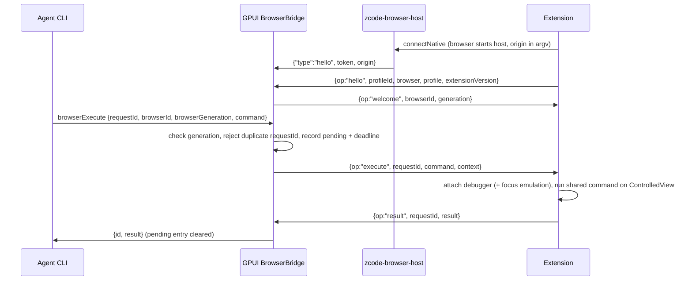

# Browser Use through your own browser (2026-10-15)

The agent's browser tool (`interaction/browserList` / `interaction/browserExecute`
reverse RPCs) drives tabs in the user's own Chromium browser (Helium, Google
Chrome) through the ZCode browser extension. Electron's in-app browser is not
ported. The extension runs the same command layer instead, through
`chrome.debugger`.

Design reference: the Codex Chrome extension and its native host (same overall
shape). Their code is proprietary and none of it is copied.

## Product rules

- **No browser connected:** the reply to `browserList` is exactly the old one
  (`{browsers: []}`), and `browserExecute` still fails fast.
- **Agent tabs:** opened as background tabs in the last focused window, inside
  a blue "ZCode" tab group. The agent never takes the user's foreground tab.
- **User tabs:** the agent can list and claim them (`listUserTabs`,
  `claimTab`). Handoff and finalize ungroup the tab and give it back. Incognito
  tabs and non-http(s) tabs are never listed.
- **Navigation:** only `http:`, `https:` and exact `about:blank` are allowed
  (`isAllowedBrowserUrl`). `chrome://` pages and other extensions' pages are
  refused.
- **Debugger banner:** while the agent works, Chrome shows its "is debugging
  this browser" banner. The debugger detaches at `turnEnded` and the banner goes
  away.
- **Phone-started turns:** these run on the desktop's agent, so they use the
  desktop's browser (REMOTE_CONTROL.md). The phone has no bridge of its own, and
  the phone build hides Settings › Browser Use.
- **Not supported yet:** recording, downloads, the file chooser, `waitForEvent`
  and history. They are hidden from the agent through `apiSupportOverrides`.
  `fill`/`waitFor` by snapshot ref are unsupported, as on Desktop; the agent
  fills through Playwright locators.

## Architecture and owners

```
Agent CLI ──stdio──► GPUI AppState.browser (BrowserBridge)
                      │ 127.0.0.1:<port>, one JSON object per line
                      │ token from ~/.zcode/v2/gpui-browser-bridge/endpoint.json
                      ▼
              zcode-browser-host(.exe)   started by the browser, keeps no state
                      │ native messaging: 4-byte length + JSON on stdio
                      ▼
              ZCode extension (MV3 service worker)
                      │ chrome.debugger / chrome.tabs / chrome.tabGroups
                      ▼
                   Browser tabs
```

| State | Single owner | Notes |
| --- | --- | --- |
| Connected browsers: descriptor id `extension:<profileId>` and generation | GPUI `BrowserBridge` (`browser_bridge/state.rs`) | Generation is `max(unix_ms, previous + 1)` on every hello. A reconnecting profile evicts its stale socket. |
| In-flight requests: request id, workspace, RPC id, deadline | GPUI `BrowserBridge` | Each request belongs to one socket. Results from another socket are ignored. |
| Tabs, lifecycle, debugger sessions, dialogs | Extension `TabManager` / `CommandRouter` | Same semantics as Desktop `browserGuestManager`: tabs owned per session scope, `turnEnded` and `closeSession` handled. |
| Command implementation | `packages/browser-commands` | Moved out of Desktop unchanged. Shared by Electron main and the extension. |
| Host registration | Windows HKCU key + manifest file | Written only from Settings › Browser Use (`browser_bridge/registration.rs`). |

The host has no state. It checks the caller origin, connects, authenticates
and copies frames.

## Event order



- **Timeout:** 30 s by default, the same budget as Desktop's host bridge.
  `playwrightWaitForTimeout` and Playwright actions get their own `timeoutMs`
  plus 2 s. On timeout GPUI sends `cancelRequest` to the extension and answers
  `timeout`. `sideEffect` is `uncertain` when the command could have changed
  the page, otherwise `none`.
- **Agent cancel:** the CLI sends `cancelRequest{requestId}` as an execute. The
  extension aborts that request only if it has the same session scope.
- **Socket lost:** every pending request on it fails as `backend_unavailable`,
  with the same `sideEffect` rule. The next hello gets a new generation, so
  older generations are rejected as stale.
- **Workspace unloaded or GPUI shutdown:** pending requests are dropped or
  answered. A workspace with a pending browser request is not idle-unloaded.
- **Delivery order:** results go back on the stdio of the workspace that sent
  the request (keyed by workspace key).

## Wire protocol

GPUI side: newline-delimited JSON on loopback TCP.

- **First line from the host:** `{"type":"hello","token","origin"}`. A wrong
  token gets `{"op":"unavailable","reason":"unauthorized"}` and the socket is
  closed. The hello must arrive within 5 s.
- **Extension to GPUI:** `hello`, then `result`.
- **GPUI to extension:** `welcome`, `execute`.
- **Host to extension, on failure:** `{op:"unavailable", reason}` (for example
  GPUI isn't running), then the host exits.

Browser side: Chromium native messaging. Each message is a 4-byte native-endian
length followed by UTF-8 JSON. Host-to-browser messages are capped at 1 MiB;
browser-to-host at 64 MiB. Screenshots travel extension-to-GPUI, inside the
larger cap.

## Security

- **Loopback only:** the listener binds `127.0.0.1:0`.
- **Endpoint token:** `endpoint.json` holds `{version, port, token, pid}`. The
  token is 32 random bytes from `ring`, hex-encoded and compared in constant
  time. The file is written via tmp-then-rename and removed on exit (only if
  the token is still ours).
- **One owner:** a second GPUI refuses to start the bridge while the recorded
  endpoint still answers. Scratch (isolated) instances never start it and
  cannot register.
- **Caller check:** the host only serves origin
  `chrome-extension://ogdkmkfjcfnbhcankdfaeddjjkohdojh/`. That is the fixed id
  from the manifest `key`, and the host manifest's `allowed_origins` names
  only it.
- **No secrets in logs:** the token and page contents are never logged. Meta
  URLs are sanitized.

## Registration (Settings › Browser Use)

- **Register** writes `<home>/.zcode/v2/gpui-browser-bridge/dev.zcode.gpui.browser.json`.
  It contains the absolute path of `zcode-browser-host.exe`, which sits next to
  `zcode-gpui.exe`, plus `allowed_origins`. The same step sets the default value
  of `HKCU\Software\Google\Chrome\NativeMessagingHosts\dev.zcode.gpui.browser`
  (Google Chrome and Helium both read this key; checked with a probe host) and
  of the matching `Software\Chromium\…` key.
- **Status:** the page shows Registered, Not registered, or "Registered for
  another copy" (for example a debug build). It also flags a missing host
  program.
- **Remove** deletes both keys and the manifest.
- **Other systems:** macOS and Linux report Unsupported. Their manifest
  directories are not implemented yet.
- **Extension folder:** `browser-extension/` next to the executable (staged by
  `scripts/package-gpui.mjs`), or else `apps/zcode-browser-extension/dist` in
  the checkout the binary was built from. Load it unpacked from
  `chrome://extensions` with Developer mode on.

## Browser findings that shaped the code

- **Background tabs need focus emulation.** A background tab reports
  `visibilityState=hidden`. Its renderer then holds the first
  `Input.dispatchMouseEvent` for about 5 s and drops mousedown/click. The
  extension sends `Emulation.setFocusEmulationEnabled{enabled:true}` on attach,
  which makes Chrome treat the tab as visible and focused. Playwright keeps
  background pages working the same way. Detaching undoes it. Screencast does
  not help.
- **No Node globals.** An MV3 service worker has no `process` or `Buffer`. The
  shared package must not touch Node globals outside `src/node/`, and a source
  scan test enforces this.
- **Target emulation.** `chrome.debugger` has no Browser domain.
  `Target.attachToTarget`, `getTargets` and `detachFromTarget` are answered from
  the sessions created by `Target.setAutoAttach{flatten}`, so cross-origin
  iframes work. This was verified with a locator into an OOPIF.
- **Brand reported as Chrome.** Helium reports the brand "Google Chrome" in
  `userAgentData`, so it is listed under that name.

## Verification (2026-10-15)

- **Unit tests:**
  - GPUI `browser_bridge`: 18 tests (state, listener and token, frames,
    registration with a fake registry and one real HKCU round trip).
  - Extension: 20 tests (fake `chrome.*`).
  - `packages/browser-commands`: moved Desktop tests plus contract and
    runtime-globals tests.
- **Stand-in bridge E2E** against the real host and the extension in a
  throwaway Helium profile, all passing:
  - list, newTab, navigate, snapshot, ref click;
  - locator fill and click;
  - locator into a cross-origin iframe;
  - screenshot;
  - getState;
  - cancellation of a 10 s wait;
  - listUserTabs, claimTab, markHandoff, nameSession;
  - turnEnded, closeSession.
- **Real agent turn:** a GPUI test copy owned the bridge. The agent (control-browser
  skill) listed tabs, claimed the open form tab, filled it, clicked Go, read
  "Hello GPUI" and took a screenshot. Settings › Browser Use showed the bridge
  address and the connected browser, and its Register button wrote both keys.
- **Not run:** Google Chrome itself (not installed on the test machine).

## Out of scope for now

Recording, downloads, file uploads, per-origin policies (Codex's Apache-2.0
`browser_use.rs` origin model could be adopted later, with attribution),
macOS/Linux registration, Web Store publishing, and keeping the tab registry
across service-worker restarts.
