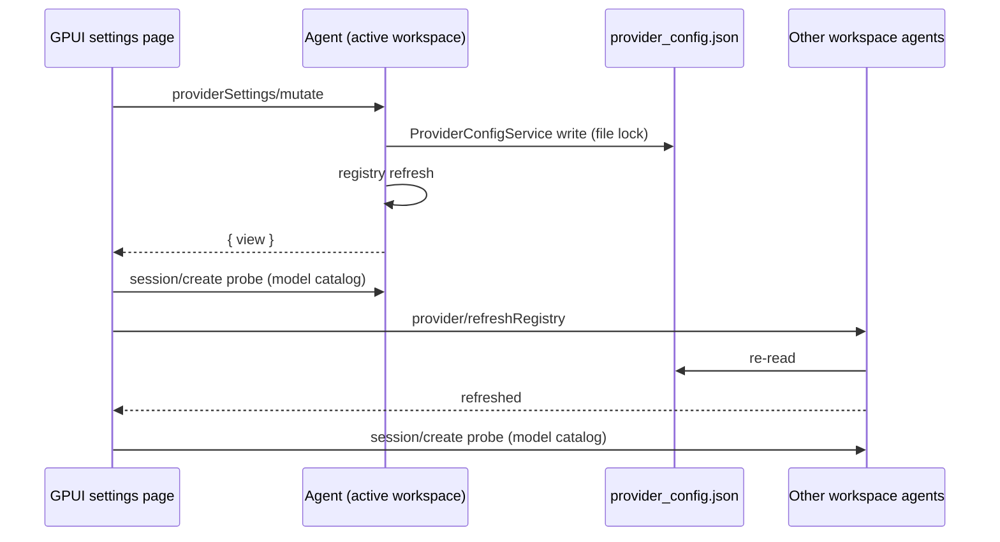

# Model settings: provider management (GPUI)

Settings → Model settings matches the desktop "Model Provider" section for
API-key providers: a provider list on the left, the selected provider's card on
the right, editing written through the agent CLI.

## Product rules

Mirrors `packages/ui/src/settings/model-provider-section` (desktop):

| Provider kind                                        | Name | Base URL / API format | API key | Enable | Delete | Models |
| ---------------------------------------------------- | ---- | --------------------- | ------- | ------ | ------ | ------ |
| Custom (`effectiveConfig.group == "standard-personal"`) | edit | edit                  | edit    | switch | yes    | add / delete own / enable / reorder / test |
| Preset (`zai-family`, `bigmodel-family`), API-key access | read | read                  | edit    | switch | no     | enable / reorder / test; built-in models not deletable |
| Preset with `access.type == "zhipu-account"`         | read | read                  | hidden  | hidden | no     | as above |

- Left list: "Preset" group, then "Custom" group in `providerOrder`; each row
  shows the name and a status dot (disabled → muted, not executable or has
  issues → warning, otherwise success). Custom providers move up/down.
- "Add provider" replaces the detail pane with the template list
  (`providerTemplates`, localized name) plus "Custom provider".
- Text fields save on Enter or blur; the API key is masked with a show/hide
  toggle. Only changed leaves are written (desktop `ProviderDraftSave.ts`).
- "+ Add model" opens the add-model dialog (see below); an unknown model saved
  with the recommended config then shows its config issues in the list.
- Delete provider asks for confirmation inline.
- Test sends `provider/testModelConnectivity` for that model.

### Add-model dialog

Mirrors desktop `ProviderModelMetadataDialog` in `mode="add"`
(`ProviderCardSections.tsx`, `ProviderModelMetadata.ts`,
`ProviderModelDraftState.ts`, `useProviderModelDraft.ts`).

- Fields: "Smart configuration" switch (default on); Model ID (mono);
  context window; max output tokens (digits only, disabled until the ID is
  non-empty); collapsible "Advanced settings": input types (Text always on,
  Image / Video / PDF toggles), capabilities (structured output, native web
  search, mid-conversation system messages), ordered reasoning levels
  (add / remove), reasoning parameter mapping and max-output parameter mapping
  (option-map expressions, multi-line mono inputs).
- Smart mode: ~1.2 s after the ID stops changing (or on ID blur) the dialog
  sends `providerSettings/resolveModelConfig { providerId, modelId }`; the
  response's `inheritedConfig` fills placeholders and the values of controls
  the user has not touched. Only the response to the latest request is used.
  Saving in smart mode without a resolution for the current ID resolves first,
  then saves.
- Switching smart → manual fills empty context window / max output / mapping
  inputs from the current baseline; manual → smart resets the draft to the
  recommended defaults (keeps the ID).
- Save validates exactly like desktop `resolveProviderModelDraftCommit`
  (ID required and not already in the provider; positive integers; Text input
  required; reasoning levels non-empty, trimmed and unique; a reasoning map must
  be typed or inherited) and shows the error inline. The map expressions are
  compiled by the agent; a compile error comes back as the save error.
- Output: smart mode sends a sparse overlay (only explicit overrides), manual
  mode the materialized editable leaves (desktop `extractManualModelConfig`).
  A typed max-output mapping is an explicit `optionSpecs.maxOutputTokens.map`
  override in both modes (GPUI addition; desktop has no field for it).
- Enter in a single-line field saves, Escape / Cancel closes. The dialog closes
  only when the agent accepted the mutation; an agent error stays in the dialog.

Not in scope (still desktop-only): Z.ai / BigModel account sign-in, coding-plan
status/quota/purchase panels, and editing an existing model's metadata.

## Ownership and protocol

`~/.zcode/v2/provider_config.json` has one writer implementation:
`ProviderSettingsFacade` + `ProviderConfigService` from `@zcode/provider`. The
desktop runs it in the Services host; GPUI reaches the same code inside the
agent CLI through two methods:

- `providerSettings/read { refresh?: boolean }` → `{ view }`
- `providerSettings/mutate { operation }` → `{ view, providerId? }` where
  `operation.type` is `createProvider`, `updateProvider`, `deleteProvider`,
  `reorderProviders`, `addModel`, `deleteModel`, `setModelEnabled`,
  `reorderModels`. `addModel` takes optional `config` (model config object,
  `modelConfigDataSchema`) and `useRecommendedConfig` (default `true`).
- `providerSettings/resolveModelConfig { providerId, modelId, personalConfig? }`
  → `{ inheritedConfig, effectiveConfig, issues }` (read-only; wraps
  `ProviderSettingsFacade.resolveModelConfig`, a `personalConfig` previews that
  draft overlay). Not serialized with mutations.

`view` is the facade's `ProviderSettingsView` (revision, templates, order,
providers with `effectiveConfig`, `personalConfig`, models, issues). It
contains API keys in plain text, exactly like the desktop page; it is never
logged by GPUI.

GPUI holds the last `view` as a cache only; every mutation response replaces
it. Requests are serialized per page (one in flight; controls disabled while
busy).

An agent built before these methods answers `-32601`; the page then shows the
read-only catalog it had before.
