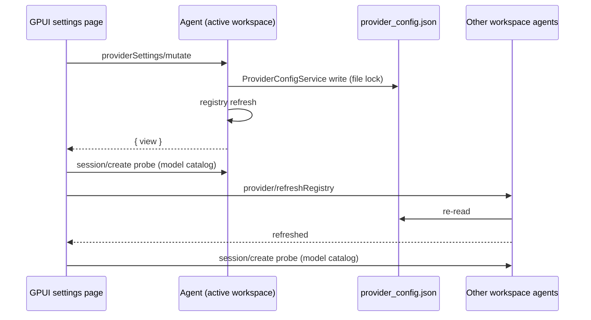

# Model settings: provider management (GPUI)

Settings → Model settings matches the desktop "Model Provider" section for
API-key providers: a provider list on the left, the selected provider's card on
the right, editing written through the agent CLI.

## Product rules

Mirrors `packages/ui/src/settings/model-provider-section` (desktop):

| Provider kind                                        | Name | Base URL / API format | API key | Enable | Delete | Models |
| ---------------------------------------------------- | ---- | --------------------- | ------- | ------ | ------ | ------ |
| Custom (`effectiveConfig.group == "standard-personal"`) | edit | edit                  | edit    | switch | yes    | add / delete own / enable / reorder / test |
| Preset (`zai-family`, `bigmodel-family`), API-key access | read | read                  | edit    | switch | no     | enable / reorder / test; built-in models not deletable |
| Preset with `access.type == "zhipu-account"`         | read | read                  | hidden  | hidden | no     | as above |

- Left list: "Preset" group, then "Custom" group in `providerOrder`; each row
  shows the name and a status dot (disabled → muted, not executable or has
  issues → warning, otherwise success). Custom providers move up/down.
- "Add provider" replaces the detail pane with the template list
  (`providerTemplates`, localized name) plus "Custom provider".
- Text fields save on Enter or blur; the API key is masked with a show/hide
  toggle. Only changed leaves are written (desktop `ProviderDraftSave.ts`).
- "Add model" takes a model ID and saves it with the recommended config
  (`useRecommendedConfig: true`); an unknown model then shows its config issues.
- Delete provider asks for confirmation inline.
- Test sends `provider/testModelConnectivity` for that model.

Not in scope (still desktop-only): Z.ai / BigModel account sign-in, coding-plan
status/quota/purchase panels, and the per-model metadata dialog (its sparse
override rules live in the React package and are not duplicated here).

## Ownership and protocol

`~/.zcode/v2/provider_config.json` has one writer implementation:
`ProviderSettingsFacade` + `ProviderConfigService` from `@zcode/provider`. The
desktop runs it in the Services host; GPUI reaches the same code inside the
agent CLI through two methods:

- `providerSettings/read { refresh?: boolean }` → `{ view }`
- `providerSettings/mutate { operation }` → `{ view, providerId? }` where
  `operation.type` is `createProvider`, `updateProvider`, `deleteProvider`,
  `reorderProviders`, `addModel`, `deleteModel`, `setModelEnabled`,
  `reorderModels`.

`view` is the facade's `ProviderSettingsView` (revision, templates, order,
providers with `effectiveConfig`, `personalConfig`, models, issues). It
contains API keys in plain text, exactly like the desktop page; it is never
logged by GPUI.

GPUI holds the last `view` as a cache only; every mutation response replaces
it. Requests are serialized per page (one in flight; controls disabled while
busy).

An agent built before these methods answers `-32601`; the page then shows the
read-only catalog it had before.
