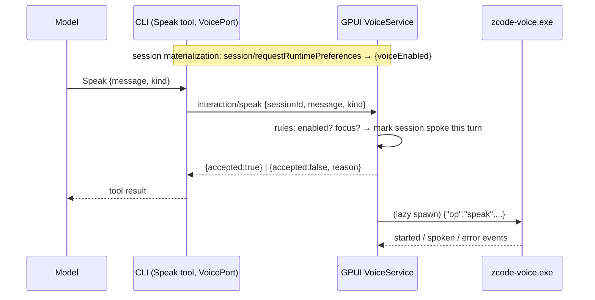

# Voice: agents speak to the user (GPUI desktop only)

Status: spec for the 2026-10-16 slice. GPUI-only feature; Electron does not enable it.

## Product rules

- The main agent of a session gets a built-in **`Speak`** tool. It says one short plain
  sentence aloud on the PC, for: needing the user's attention (question, permission,
  blocker), a task being done, or a plan being ready. It is not for progress narration.
- **Only the PC speaks.** The Android phone build never contains the engine. Reverse RPCs are
  never forwarded to a phone (`remote/gateway.rs` `route_cli_line_to_phone` only forwards
  responses and owned `v4/conversation/frame` lines), so a turn started from the phone still
  speaks on the PC and the phone stays silent.
- **Subagents never get the tool**, so parallel workers can't talk over each other.
- **Fallback lines.** When a session shows a permission request, an AskUserQuestion, or a
  plan approval (ExitPlanMode), and that session has not had a Speak call accepted since its
  current turn started, GPUI itself says a fixed line: "Permission needed", "Question
  waiting" or "Plan ready". Each interaction id is announced at most once.
- Settings › Voice (desktop only, hidden on the phone like Browser). Stored as one
  GPUI-only object `gpuiVoice` in `setting.json`, so Electron ignores it:
  - **Let agents speak** (`enabled`, default off).
  - **Voice** (`voice`, default `af_sky`). Only English Kokoro voices are listed
    (`a*` American, `b*` British): the ones the engine reports, else a built-in list.
  - **Speed** (`speed`, 0.5–2.0, default 1.0) and **Volume** (`volume`, 0–1, default 0.8).
  - **Only when ZCode isn't focused** (`onlyWhenUnfocused`, default off).
  - **Test voice** button (works while Voice is off, to try a voice first) and a status
    line: Not started, Loading, Downloading model n%, Ready, or the error (engine not found,
    eSpeak data missing, download failed, model load failed, audio).
- Turning Voice **on** applies to sessions materialized afterwards (new or resumed), because
  the CLI reads runtime preferences when it materializes a session. Turning it **off**
  applies at once: GPUI rejects Speak calls with `disabled`, and fallback lines stop.

## State owners

| State                                                                | Owner                                                                                    |
| -------------------------------------------------------------------- | ---------------------------------------------------------------------------------------- |
| Whether a session's tool list contains `Speak`                       | CLI, from `voiceEnabled` in the session's runtime preferences reply (main sessions only) |
| Voice settings                                                       | `setting.json` via GPUI `Preferences` (`gpuiVoice` object)                               |
| Speak acceptance, "spoke this turn" flags, announced interaction ids | GPUI `VoiceService` (global, desktop only)                                               |
| Sidecar process, model, playback queue                               | `zcode-voice.exe`, owned and spawned by `VoiceService`                                   |

## Protocol

`interaction/speak` (CLI → client reverse request):

- params `{ sessionId: string, message: string (1–300 chars), kind: "attention" | "done" | "planReady" | "info" }`
- result `{ accepted: boolean, reason?: "disabled" | "unfocusedOnly" | "unavailable" }`

Hosts without the method answer `-32601`; the CLI maps that, `-32020` (no client) and
timeouts (5 s) to `{accepted:false, reason:"unavailable"}`. The GPUI phone build and a
desktop without the sidecar answer `unavailable`.

`session/requestRuntimePreferences` result gains an optional `voiceEnabled: boolean`. Only
`true` enables the tool, so Electron and older hosts that omit it never do. The GPUI
desktop sends `true` when it has a voice service and the setting is on.

The tool returns once GPUI has accepted the speech, not when playback ends.

## Sidecar `apps/zcode-voice`

Separate Cargo project (GPL-3.0: it statically links espeak-ng through kokoro-tiny/espeak-rs).
GPUI finds `zcode-voice(.exe)` at `ZCODE_GPUI_VOICE_PROGRAM`, next to its own executable,
or in `apps/zcode-voice/target/{release,debug}` for dev builds, and starts it with
`--model-dir ~/.zcode/v2/voice`. It is assigned to GPUI's kill-on-close job object and
stopped 30 seconds after its last line finished: GPUI counts lines sent but not yet
`spoken`, `dropped` or failed, and never stops it while that count is non-zero (which also
covers the first-run model download). A restart reloads the model from the OS file cache in
about 0.6 s, so keeping the ~450 MB process resident between lines buys little.

- stdin commands (NDJSON): `{"op":"speak","id","text","voice","speed","volume"}`,
  `{"op":"stop"}`, `{"op":"status"}`. Closing stdin stops speech and exits.
- stdout events: `loading`, `downloading {file, percent}`, `ready {voices}`,
  `started {id}`, `spoken {id}`, `dropped {id}`, `error {id?, code, message}` with codes
  `bad_command`, `espeak_missing`, `model_download_failed`, `model_load_failed`,
  `synth_failed`, `audio_failed`. kokoro-tiny prints its own text to stdout, so readers skip
  lines that aren't events.
- Model files `0.onnx` (~325 MB) and `0.bin` (~28 MB) download on first start into the
  model dir, with HTTP status and length checked, via a `.part` file and rename.
- eSpeak NG data: `espeak-ng-data` next to the exe (built from the same espeak-ng source as
  the linked library), else the cargo build output
  (`target/<profile>/build/espeak-rs-sys-*/out/share`), else `%ProgramFiles%\eSpeak NG`.
- Playback goes through its own rodio sink on the system default device, a fresh stream per
  utterance. The queue holds at most 3 waiting jobs and drops the oldest.

Build needs cmake and libclang (`LIBCLANG_PATH`; the `libclang` pip wheel works) and
`CMAKE_POLICY_VERSION_MINIMUM=3.5` with cmake 4. `ndarray-npy` is vendored because every zip
5–7 release is yanked; `ort` is pinned to `=2.0.0-rc.11` because rc.14 broke kokoro-tiny.
The exe imports `DirectML.dll` (ONNX Runtime's prebuilt build), which cargo copies next to
it. `scripts/package-gpui.mjs` builds the sidecar and copies `zcode-voice.exe`,
`DirectML.dll`, `espeak-ng-data/` and `NOTICE.md` into `dist/zcode-gpui`; a failed voice
build only warns (`--skip-voice` skips it).

## Acceptance scenarios

1. Voice on, the agent finishes a task and calls Speak: the PC says the sentence once; the
   tool result says it was spoken.
2. Plan mode, the agent calls ExitPlanMode without Speak: GPUI says "Plan ready" once.
3. The agent called Speak earlier in the same turn, then asks a question: no fallback line.
4. Voice off: the tool is absent from new sessions; in a session started while on, Speak
   returns `disabled` and nothing plays.
5. Turn started from the phone: the PC speaks, the phone does not.
6. `voiceOnlyWhenUnfocused` on and the window focused: Speak returns `unfocusedOnly`.
7. eSpeak data missing: the sidecar fails at start, Settings › Voice shows the eSpeak hint,
   and later Speak calls return `unavailable` (each one retries the engine).
8. Electron host: no `voiceEnabled` → no Speak tool; nothing changes.
